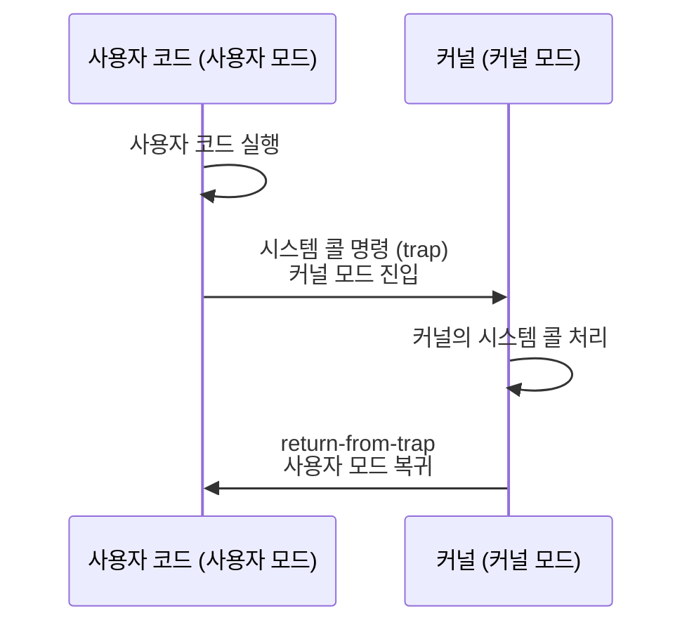

## 오늘 읽을 페이지

**필독**
- 제4장 프로세스의 개념: p.27~35
- 제5장 프로세스 API: p.39~48
- 제6장 제한적 직접 실행 원리: p.53~65
- 제7장 스케줄링 개요: p.69~78
- 제8장 멀티 레벨 피드백 큐: p.83~91

**선택**
- 제9장 비례 배분: p.95~106
- 제10장 멀티프로세서 스케줄링: p.109~118

## 오늘의 목표

프로그램 실행 → 프로세스 생성 → 사용자 코드 실행 → 커널 진입 → CPU 전환의 전체 흐름을 연결한다.

## 읽을 주제

- 프로세스와 주소 공간
- 프로세스 API: `fork`, `exec`, `wait`
- 제한적 직접 실행
- 사용자 모드와 커널 모드
- 시스템 콜, trap, interrupt
- 컨텍스트 스위칭
- CPU 스케줄링
- FIFO, SJF/STCF, Round Robin, MLFQ의 핵심 아이디어

## 반드시 답할 질문

### 프로그램과 프로세스의 차이는 무엇인가?

프로그램은 디스크에 파일로 저장되어 있는 정적인 명령어 집합이다.

프로세스는 프로그램의 실행을 위한 인스턴스에 해당한다. 메모리, CPU 등의 자원을 소유하고, 프로그램의 일부를 메모리에 load하여 실행할 수 있다.

### 프로세스의 실행 문맥에는 무엇이 포함되는가?

프로세스 실행을 위해 필요한 데이터를 의미한다. Context Switching에 필요한 정보와 프로세스 자체 정보는 구분한다.

- 하드웨어 상태(PC, SP, 레지스터 등)
- 메모리(코드, 데이터, 힙, 스택)
- OS 자원(fd, 프로세스 정보, 스케줄링 상태 등)

### 사용자 프로그램이 직접 특권 명령을 실행할 수 없는 이유는?

사용자 프로그램이 직접 특권 명령을 수행하게 되면 하드웨어 장치에 자유롭게 접근할 수 있다. 이때 사용자 프로그램의 불법적인 접근(다른 프로세스의 메모리 접근, 열린 파일 외 접근 등)이 가능할 수 있으므로, 제한된 환경(사용자 모드)에서 구동하도록 강제된다.

### 시스템 콜은 일반 함수 호출과 무엇이 다른가?

일반 함수 호출은 사용자 권한 상태에서 호출 위치와 스택을 변경한다.

시스템 콜은 사용자 모드에서 커널 모드로 전환된다. 전환된 후에는 특권 명령을 처리하고 다시 사용자 모드로 돌아간다.

### OS는 실행 중인 프로세스로부터 CPU 제어권을 어떻게 되찾는가?

timer interrupt를 발생시키는 하드웨어가 일정 주기로 CPU를 인터럽트한다. 인터럽트를 받은 CPU는 인터럽트 허용 범위와 우선순위를 고려하여 커널 모드로 들어간다. 이미 커널 모드면 그대로 유지한다.

커널 모드에서 운영체제는 timer interrupt에 따라 프로세스를 중단하거나 다른 프로세스를 실행할 수 있다.

### timer interrupt가 없다면 어떤 문제가 생기는가?

협조적인 프로세스가 직접 시스템 콜을 호출하기 전까지 운영체제는 "실행 중이 아니기 때문에" 주기적으로 CPU를 회수할 수단이 부족하다.

### 컨텍스트 스위칭 때 무엇을 저장하고 복원하는가?

1. 하드웨어가 현재 실행 중인 프로세스 A의 레지스터를 보존하며 A의 커널 스택을 사용한다.
2. 커널에서 A의 재개 상태를 저장한다.
3. B의 저장된 커널 context를 복원하고, B의 커널 스택과 주소 공간을 사용하도록 전환한다.
4. B가 커널에서 중단됐던 지점부터 실행된다.
5. 커널 작업을 마친 뒤 B의 사용자 레지스터 상태를 복원하고 사용자 모드로 들어간다.

### 컨텍스트 스위칭의 직접 비용과 간접 비용은 무엇인가?

**직접 비용**
- PCB 교체 비용, 스케줄러 계산 비용, 하드웨어 비용(커널 모드 <> 사용자 모드)
- 예측 가능한 오버헤드

**간접 비용(비쌈)**
- CPU Cache, TLB의 캐시 미스와 메모리 직접 조회 비용
- 데이터 크기에 따라서 달라진다.

### 처리량, 응답시간, 반환시간은 어떻게 다른가?

- 처리량은 일정 시간 동안 처리하는 작업의 개수이다.
- 응답시간은 작업이 도착한 뒤 처음으로 시작되기까지 걸리는 시간이다.
- 반환시간은 작업이 도착하고 나서 완료되기까지 걸리는 시간이다.

프로세스 A가 실행되어 작업 리스트에 들어갔다고 할 때, 0초에 작업 리스트에 도착, 5초에 처음으로 실행, 20초에 최종 완료되었다면 응답시간은 5초, 반환시간은 20초다.

스케줄링 알고리즘에서 응답시간을 개선하면 반환시간이 악화되고, 그 반대도 마찬가지인 경우가 많다.

### Round Robin의 time slice가 너무 작거나 크면 어떻게 되는가?

너무 작으면 오히려 context switching 빈도가 높아져서 시스템 성능이 저하된다.

응답시간을 빠르게 하려는 의도의 Round Robin인데, time slice가 너무 크면 응답시간이 늦어져서 의미가 퇴색된다.

### MLFQ가 해결하려는 문제는 무엇인가?

짧은 CPU time을 가지는 반응형 프로그램은 빠르게 실행되면 좋고, 긴 CPU time을 가지는 계산형 프로그램은 비교적 천천히 실행되어도 괜찮다. 하지만 프로그램의 실행 시간을 미리 알기 어렵다는 한계가 있다. 그래서 작업이 실행되며 보여온 특성에 따라서 스케줄링을 다르게 관리할 수 있는 기법이다.

**규칙**
1. 우선순위(A) > 우선순위(B)일 경우, A가 실행되고 B는 실행되지 않는다.
2. 우선순위(A) = 우선순위(B)일 경우, A와 B는 RR 방식으로 실행된다.
3. 작업이 시스템에 들어가면 최상위 큐에 배치된다.
4. 작업이 지정된 큐에서 지정된 시간을 소진하면, 작업의 우선순위가 감소한다. (한 단계 아래 큐로 이동)
5. 일정 주기 S가 지난 후, 모든 작업을 최상위 큐로 이동한다.

{: w="960" h="430" }
_MLFQ 규칙 1~5_

전체적으로는 SJF/STCF를 달성하려고 목표하면서, 짧은 응답시간이 필요한 작업들에 대해서는 RR을 통해 해소한다.

### CPU-bound 작업과 I/O-bound 작업을 스케줄러는 어떻게 다르게 보게 되는가?

I/O-bound 작업은 실제 CPU 사용 시간이 짧으므로, SJF 기법에서 앞쪽에 할당할 수 있다. 실제로 I/O 작업을 수행하는 동안 다른 CPU 작업을 수행할 수 있으므로 효율적인 스케줄링이 가능하다.

- 셸 창에서 사용자와 실시간 대화를 하는 경우엔 짧은 CPU-I/O 작업이 연달아 발생할 수 있고
- 파일, 네트워크 I/O가 필요한 작업은 짧은 CPU 작업과 긴 I/O 작업이
- I/O 작업으로 읽어온 대규모 데이터를 계산하는 동안에는 긴 CPU 작업이 필요하다.

스케줄러 입장에서는 CPU-bound 작업은 응답시간이 길어도 비교적 괜찮은 것으로, I/O-bound 작업은 빠른 응답시간이 필요한 것으로 간주할 수 있다.

## 반드시 그릴 그림

사용자 코드 실행 → 시스템 콜 명령 → 커널 모드 진입 → 커널의 시스템 콜 처리 → 사용자 모드 복귀

그리고 프로세스 A에서 B로 전환될 때 다음 항목의 변화를 표시한다.
- CPU register
- PC / SP
- kernel stack
- page table 기준점
- scheduler/run queue

## 실습

아래 중 두 개를 선택한다.
- 작은 프로그램을 `strace`로 실행해 시작부터 종료까지 시스템 콜 관찰
- C로 `fork` → `exec` → `wait` 프로그램 작성
- CPU-bound 프로세스 여러 개를 실행하고 `top`에서 상태 관찰
- OSTEP CPU 스케줄링 시뮬레이터로 FIFO와 RR의 응답시간 비교
- `/proc/<pid>/status`에서 프로세스 상태와 context switch 수 확인

## 오늘의 결과물

- CPU 가상화 전체 흐름 그림 1개
- 스케줄링 정책 비교표 1개
- 2분 설명: **"OS가 CPU를 빼앗아 다른 프로세스에 주는 과정"**

## 스케줄링 비교표

| **정책** | **핵심 기준** | **장점** | **단점** | **적합한 상황** |
|---|---|---|---|---|
| FIFO | 도착 순서 | 단순함 | 실행 시간이 다른 작업들이 섞여 있을 경우 전체 성능이 저하됨 | 응답성이 낮은 단순한 작업 처리 |
| SJF/STCF | 빨리 끝나는 순서 | 짧은 작업을 빠르게 처리 | 평균 응답 시간이 긺 | 실행 시간을 미리 알고 있을 때 (일괄 처리 시스템) |
| Round Robin | 일정 간격으로 순환 | 평균 응답 시간이 짧음 | Context Switching 비용, 평균 반환 시간이 긺 | 응답성이 중요한 시분할 환경 |
| MLFQ | 작업 특성에 따른 우선순위 | 작업의 특성에 맞게 배분 | 복잡함. 잘못 설계할 시 기아 현상과 독점 현상이 발생할 수 있음 | 대부분의 현대식 시스템 |

## 내 질문

### `fork()`로 생성된 자식 프로세스에서 `exec()`를 호출하면, 부모가 `wait()` 중일 때 어떻게 되나?

`exec()`는 프로세스는 그대로, 실행하는 프로그램만 바꾸는 것이다. `wait()`는 동일하게 자식 프로세스를 기다린다.

### `wc p3.c > newfile.txt`일 때 `exec()` 전에 stdout을 닫고 `newfile.txt`를 열어뒀다고 하면, fd는 `exec()`해도 그대로인가?

- 범용 레지스터와 PC, SP 등은 새로운 프로그램을 위한 값으로 바뀐다.
- 필요한 주소 공간의 정보도 새 프로그램에 맞게 바뀐다.
- PID, 부모 자식 관계, 열린 fd 등은 유지된다.
- 사용자 시그널 핸들러는 날아간다.

### 인터럽트가 발생하면 CPU 하드웨어 자체에서 그 신호를 받고, 해당 신호에 맞는 OS kernel 주소의 명령어를 실행하는 건가?

CPU에서 미리 등록되어 있는 코드를 실행한다.

### 커널 스택?

OS 코드는 모든 프로세스가 공유하고 있고, 각자의 커널 스택도 메모리에 로드된 커널 영역 내에서 따로 가지고 있다.

사용자 영역에서의 스택이 사용자 모드의 실행 분기를 저장하는 역할이라면, 해당 프로세스가 커널 모드로 진입했을 때 실행 분기를 저장하기 위한 것이 각 프로세스별 커널 스택이다.

### 사용자 모드와 커널 모드는 결국 하드웨어의 실행 모드 차이인 건가?

하드웨어에서도 모드의 차이가 존재한다. 단순히 PC / SP만 바꿔 끼운다고 자연스레 커널 명령을 실행할 수 있는 게 아니다. 일반 사용자가 커널로 jump 해버리면 의미가 없기 때문에 하드웨어에서도 커널/사용자 모드를 엄격하게 구분한다.

### Ubuntu의 MLFQ는? - 기본 Linux 스케줄러. 최신에서는 또 다름

Completely Fair Scheduler, CFS를 사용한다.

스케줄러의 성능 자체도 시스템 전체 성능에 큰 영향을 미치기 때문에, 최대한 효율적이고 공정한 방식으로 스케줄링한다.

- 우선 기본적으로 RR 방식을 채택한다. 하지만 time slice를 가변적으로 적용한다.
- 프로세스마다 `vruntime` 시간을 할애하고, 프로세스가 실행되면 `vruntime`을 증가시킨다.
- 다음에 실행할 프로세스는 `vruntime`이 가장 낮은 프로세스이다. 이때 탐색을 위해 Red-Black Tree를 사용하여 O(logN) 시간 내에 탐색한다.
- CFS는 `sched_latency` 변수를 사용한다. OSTEP 기준 48ms이고, 이 값을 전체 프로세스 수로 나눈 게 time slice가 된다.
- 프로세스가 많아지면 이 값이 작아져서 context switching 문제가 발생할 수 있다. 그래서 하한선을 정해둔 게 `min_granularity` 변수이다. OSTEP 기준 6ms다.
- CFS는 가중치 `nice`를 사용해서 우선순위를 부여할 수 있다. 값은 -20부터 19까지다. 음수일수록 우선순위가 높다. 우선순위가 높으면 `vruntime`이 실제 실행 시간보다 적게 증가하고, time slice를 더 많이 할당받는다.

