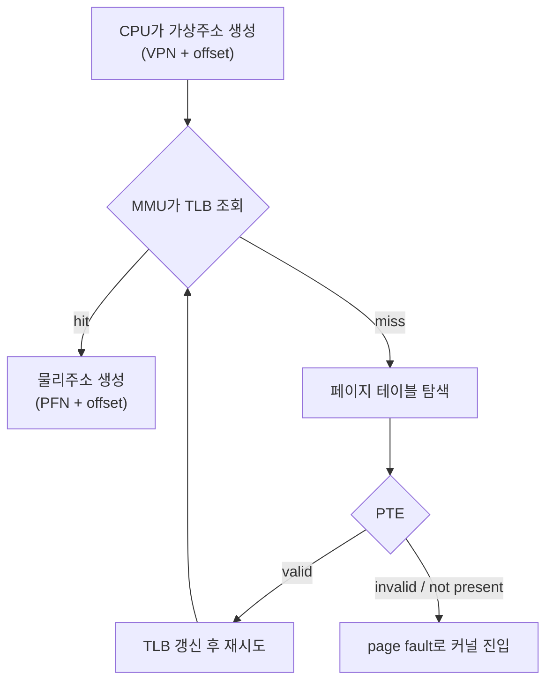

## 오늘 읽을 페이지

**필독**
- 제13장 주소 공간의 개념: **p.127~132**
- 제15장 주소 변환의 원리: **p.149~160**
- 제18장 페이징 개요: **p.195~206**
- 제19장 TLB: **p.211~223**
- 제20장 더 작은 페이지 테이블: **p.229~242**
- 제21장 물리 메모리 크기의 극복, 메커니즘: **p.245~252**
- 제22장 물리 메모리 크기의 극복, 정책: **p.257~271**

**선택**
- 제14장 메모리 관리 API: **p.137~144**
- 제16장 세그멘테이션: **p.165~173**
- 제17장 빈 공간 관리: **p.177~191**
- 제23장 완전한 가상 메모리 시스템: **p.277~294**

시간이 부족하면 제20장은 멀티 레벨 페이지 테이블 **p.233~240**을 중심으로 보고, 제23장은 생략한다.

## 오늘의 목표

CPU가 만든 가상주소가 물리 메모리에 도달하는 과정과, 메모리가 부족할 때 발생하는 일을 설명한다.

## 읽을 주제

- 주소 공간
- 주소 변환
- 페이징과 페이지 테이블
- multi-level page table
- TLB
- 페이지 폴트
- demand paging
- swap
- 페이지 교체 정책
- 메모리 할당과 빈 공간 관리의 기본 개념
- 세그멘테이션은 장단점과 외부 단편화까지만 확인해도 된다.

## 반드시 답할 질문

### 모든 프로세스가 자신만의 주소 공간을 가져야 하는 이유는?

서로 다른 프로세스가 같은 메모리 영역을 공유한다면 각자의 데이터 정합성이 깨지는 문제가 발생한다.

물론 공유 메모리를 사용할 수도 있지만, 이는 보통 바이너리 세마포어와 같이 race condition에 대한 방어 로직을 함께 사용하는 특수한 경우에 해당된다. 공유 메모리를 사용하더라도 각 프로세스의 명령어 분기 순서와 같은 스택 영역 등은 반드시 분리되어야 한다.

### 가상주소와 물리주소는 어떻게 다른가?

물리주소는 메모리의 실제 주소를 의미한다.

가상주소는 한 프로세스 내에서 표현되는 메모리 위치이며, 가상주소는 OS가 관리하는 page table을 바탕으로 MMU에 의해 실제 물리주소로 변환된다.

### 주소 변환에서 OS와 MMU는 각각 무엇을 담당하는가?

쉽게 생각하면 **OS가 준비물을 다 챙겨주면 MMU가 빠르게 연산하는 시스템**이다.

OS가 page table을 생성 및 관리하고, context switching 시 PTBR을 CR3에 갱신한다. 또한 swap할 page를 선정하거나, page fault가 발생했을 때의 처리 로직을 구현한다.

MMU는 OS가 알려준 PTBR과 page table entry 값을 참조하여 프로세스의 VPN을 PFN으로 변환하여 빠르게 물리 메모리에서 값을 가져온다. 이 과정 안에서 문제가 발생하면(page fault, 소프트웨어 관리 TLB라면 TLB miss도) 트랩을 발생시켜 문제 해결을 OS에게 맡긴다.

### page size가 커지거나 작아질 때 장단점은 무엇인가?

page size가 커지면 전체 페이지 수가 줄어들어 page table 저장에 필요한 메모리 영역을 아낄 수 있다. 또한 TLB hit 횟수도 증가한다. 하지만 페이지 내부에서 낭비되는 공간, 즉 내부 단편화가 더 많이 발생하게 된다.

page size가 작아지면 페이지를 더 정교하게 할당함으로써 내부 단편화를 최소화할 수 있다. 하지만 전체 페이지의 수가 늘어나서 page table을 저장하기 위한 메모리 영역이 더 많이 필요하다.

### 페이지 테이블이 큰 이유는 무엇인가?

페이지 테이블은 프로세스가 사용하는 모든 페이지의 변환 정보를 저장해야 한다. 통상적인 페이지 크기는 4KB(2^12)이며, 이때 32bit 시스템에서는 프로세스마다 2^20개의 page 수를 사용할 수 있다.

변환 정보를 나타내는 PTE가 4바이트(2^2) 크기이며, 2^2 * 2^20 = 2^22 = 4MB에 해당한다.

### multi-level page table은 어떤 공간 낭비를 줄이는가?

리스트 형태의 page table은 프로세스에 할당된 모든 페이지에 대해 메모리를 할당받는다. 실제로 사용하지 않는 주소 공간에 대해서도 불필요하게 메모리 영역을 할당받는다. 어떻게 보면 page table 안에서도 내부 단편화가 발생했다고 볼 수 있다.

위에서 본 사례처럼 단순한 선형 리스트로는 프로세스마다 변환 정보에 4MB를 차지하므로, 효율적인 page directory를 사용한다. 하나의 page table을 여러 page table로 나누고, 실제로 사용하는 page가 있는 page table만 할당하는 방식이다.

가상주소가 VPN + offset으로 나뉠 때, 선형 리스트에서는 VPN 그 자체가 PTindex 역할을 했다면 page directory에서는 VPN이 PDindex + PTindex로 구성되어 있다. 상위 8비트를 Page Directory에 사용하면 page table 수는 256개가 되고, 한 page table 안에는 4096개의 PTE가 있게 된다.

{: w="960" h="490" }
_VPN을 PDindex + PTindex로 나눠 찾아가는 2단계 페이지 테이블_

64bit 시스템에서는 표현할 수 있는 메모리 영역이 훨씬 크기 때문에 4~5 depths의 tree를 구성해서 사용한다.

### TLB hit와 miss 때 각각 어떤 일이 일어나는가?

TLB hit 시에는 TLB에 캐시된 PFN으로 VPN을 바로 바꾸어 물리 메모리에 접근한다.

TLB miss 시에는 page table base register의 값으로 프로세스의 page table이 저장된 물리 메모리에 접근하여, VPN에 해당하는 page table entry를 TLB에 캐시하고 실행하려던 명령어를 재실행한다.

### TLB miss와 page fault는 왜 전혀 다른 사건인가?

TLB miss는 VPN을 PFN으로 변환하려는 PTE가 캐시되어 있지 않음을 의미한다.

page fault는 접근하려는 page가 물리 메모리에 없는 경우에 발생한다. 프로그램이 실행되고 아직 탑재되지 않았거나, 스왑으로 인해 물리 메모리에서 내려갔거나, 과거 선형 페이지 테이블 구조에서 실제로 할당되지 않은 영역에 접근할 때 발생할 수 있다.

### 프로세스 전환 시 TLB에는 어떤 문제가 생기는가?

TLB는 VPN을 기준으로 PFN을 변환하는데, VPN은 프로세스마다 각자 관리하는 주소 공간이므로 한 프로세스의 VPN이 다른 프로세스의 물리 메모리를 접근하는 데 사용될 수 있다. 따라서 프로세스 전환 시 TLB를 비워서(모든 엔트리의 valid bit를 0으로 설정) 프로세스 실행 초기에는 TLB miss가 발생하도록 유도한다.

ASID bit를 사용하면 해당 TLB 엔트리가 어느 프로세스를 위한 정보인지 마킹해둘 수 있어서 효율적으로 프로세스를 전환할 수 있다.

### page fault가 발생하면 하드웨어와 OS는 무엇을 하는가?

MMU에서 page table entry를 조회하여 present bit가 0이면 page fault를 일으킨다. (valid bit가 0이면 잘못된 접근으로 처리)

page fault가 발생하면 CPU가 kernel mode로 전환되며, page fault handler를 실행한다.

운영체제는 page fault가 지연 로드나 스왑으로 인한 것이면, 비어 있는 프레임을 찾아서 (없으면 스왑시키고) 물리 메모리에 로드한다. 하지만 비정상적인 page 접근으로 인해 발생했다면, 그 프로세스에게 Seg fault 시그널을 날린다.

### minor fault와 major fault의 차이는 무엇인가?

결정적인 차이는 **disk I/O 필요성**이다.

minor fault는 새로운 메모리를 요청하고 실제로 할당은 받지 않은 경우에 발생한다. 이때는 disk I/O가 필요한 것은 아니고, 새로운 프레임을 매핑해주기만 하면 된다. 단, 메모리 공간 부족으로 다른 페이지를 스왑으로 내보내더라도, 접근한 페이지 자체를 디스크에서 읽어오지 않았다면 minor fault이다. 또는 프로세스가 처음 실행되고 공유 라이브러리 코드처럼 이미 메모리에 올라와 있는 페이지가 아직 매핑되지 않았으면 발생할 수 있다. 공유 라이브러리 외에 다른 공유 메모리도 해당한다.

major fault는 메모리 부족으로 인한 스왑이나, 프로그램 코드가 아직 적재되지 않은 경우에 발생한다.

### 메모리가 부족할 때 시스템 성능은 어떤 순서로 악화되는가?

1. 지연 로딩을 통해 메모리 요청은 받았지만, 실제 물리 프레임까지 동시에 할당하지는 않는다. 이때는 minor fault가 발생한다.
2. 메모리가 더 부족해지기 시작하면, swap을 통해 메모리를 실제로 disk로 내리면서 major fault가 발생한다.
3. 더 부족해지면 thrashing이 일어나기 시작하며, 프로세스는 거의 멈춘 듯이 보인다.
4. 스왑으로도 해결하기 어려운 임계점을 넘으면, OOM이 발생하여 메모리를 많이 먹는 프로세스를 죽인다.

### thrashing은 왜 발생하는가?

한 프로세스가 요구하는 메모리의 크기가 물리 메모리의 크기보다 크거나, 많은 프로세스가 메모리를 반복적으로 요청할 경우 자주 쓰는 페이지들(working set)의 합이 물리 메모리보다 커져서, 내보낸 page를 곧바로 다시 불러오는 swap이 계속 일어나게 된다. 이를 thrashing이라 한다.

운영체제는 일부 우선순위가 낮은 프로세스들의 메모리를 모두 물리 메모리에서 스왑시켜서 우선순위가 높은 프로세스들이 빠르게 처리될 수 있도록 조치하거나, 아예 몇몇 프로세스를 죽여버리는 형태로 관리한다.

### LRU를 완벽하게 구현하기 어려운 이유는?

LRU를 위해서는 page에 접근한 시간을 기록해두어야 한다. 이 기록을 위한 메모리 공간의 낭비와, 시계열 데이터 조작을 위한 소프트웨어 로직 오버헤드가 발생한다. 주소 변환은 MMU 하드웨어에서 아주 빠르게 실행되기 때문에 소프트웨어 로직이 들어가면 아주 느려지게 된다.

이런 비용을 무시하더라도, 구조적으로 하드웨어의 물리 주소 접근은 운영체제에게 보고되지 않는데, 시계열 데이터 저장을 위해 이를 보고하는 인터럽트가 매번 발생하게 되면 프로세스의 실행이 거의 불가능하게 된다. (커널이 시계열 데이터 처리하는 데 자원을 다 씀)

### 내부 단편화와 외부 단편화는 무엇이 다른가?

내부 단편화는 할당된 메모리 블록 안에서 사용되지 않아 낭비되는 메모리 영역이 발생하는 현상을 의미한다.

외부 단편화는 다른 크기로 할당된 세그먼트로 인해, 실제로는 다음 세그먼트의 크기보다 여유로운 공간을 가지고 있지만 그 공간이 조각나서 세그먼트를 온전히 할당할 연속된 메모리 공간이 부족한 현상을 의미한다.

## 반드시 그릴 그림

가상주소를 VPN + offset으로 분리하고 다음 경로를 그린다.

CPU가 가상주소 생성 → MMU가 TLB 조회 → hit: 물리주소 생성 → miss: 페이지 테이블 탐색 → valid: TLB 갱신 후 재시도 → invalid/not present: page fault로 커널 진입

## 실습

아래 중 두 개를 선택한다.
- `/proc/<pid>/maps`로 실행 중인 Go 프로그램의 주소 공간 확인
- `/proc/<pid>/status`에서 `VmSize`, `VmRSS` 비교
- `free`, `vmstat`, `top`으로 메모리와 fault 관련 지표 관찰
- 큰 배열을 할당한 뒤 일부만 접근하면서 할당 크기와 RSS 차이 관찰
- 배열을 순차 접근/랜덤 접근하며 실행 시간 비교
- OSTEP paging/TLB 또는 page replacement 시뮬레이터 실행

## 오늘의 결과물

- 주소 변환 전체 경로 그림 1개
- TLB miss vs page fault 비교표
- 2분 설명: **"가상 메모리가 프로세스 격리와 메모리 확장을 가능하게 하는 방식"**

## 비교표

| **구분** | **TLB miss** | **Page fault** |
|---|---|---|
| 의미 | VPN에 해당하는 PTE가 TLB에 없다. | VPN에 해당하는 PTE가 invalid하다. |
| 처리 주체 | MMU | OS |
| 데이터가 RAM에 있는가 | 모른다. | 없다. |
| 일반적인 비용 | 물리 메모리 접근 2회(캐시 갱신 + 값 조회) | Disk I/O |
| 처리 과정 | 물리 메모리에 적재된 page table에서 PTE를 캐시한 뒤 명령어를 재시도한다. | Disk에서 올바른 페이지를 찾아서 물리 메모리 프레임에 적재하고 PTE.valid를 갱신한다. |

## 내 질문

### ASID는 실제 PID보다 표현할 수 있는 수가 적은데, 스위칭되는 프로세스의 수가 ASID보다 클 때 어떻게 동작하는가?

ASID 값에 대한 PID 매칭 테이블도 가지고 있어야 하는 건가?

ASID는 PID처럼 프로세스마다 고정으로 붙는 번호가 아니라 TLB를 위한 캐시 태그에 가깝다. x86 PCID는 12bit(4096개), ARM은 8/16bit라 프로세스 수보다 적은 게 정상이다.

하드웨어는 현재 실행 중인 ASID 하나만 알고(x86은 CR3 하위 비트), 어떤 주소 공간이 어떤 ASID를 쓰는지는 커널이 `mm_struct`에 기록한다. PID가 아니라 주소 공간 단위라서 같은 프로세스의 스레드들은 ASID를 공유한다.

ASID가 부족하면 재활용한다. ARM64 리눅스는 ASID에 세대 번호를 붙여서, 다 쓰면 세대를 올리고 TLB 전체를 flush한 뒤 다시 할당한다. x86 리눅스는 CPU마다 몇 개의 PCID 슬롯만 돌려 쓰고, 슬롯을 뺏을 때 그 PCID의 TLB 엔트리만 지운다.

결국 ASID는 최근 실행된 프로세스의 TLB 엔트리를 flush 없이 살려두는 최적화라서, 모자라면 flush가 조금 더 잦아질 뿐 동작이 틀리지는 않는다.

### 나의 흐름 정리

CPU에서 가상 주소를 먼저 물리 주소로 변환을 시도한다. 이건 이번에 공부한 MMU에서 처리하는 과정이다. 그와 동시에 CPU cache에서 물리 주소로 데이터가 있는지 조회한다. L1, L2, L3에 모두 없으면 물리 메모리에서 직접 가져온다.

MMU는 가상 주소를 받으면 VPN(PD, PT) + offset으로 나누고 TLB에서 VPN > PFN 정보를 찾는다. TLB hit & valid면 PFN+offset을 반환한다. TLB miss면 CR3의 PTBR을 참고하여 물리 메모리에서 프로세스의 page table을 조회해 VPN에 해당하는 PTE를 TLB에 캐시한다. 그 뒤 명령어를 재시도한다.

최초 시도 혹은 재시도 결과가 TLB hit & invalid인 경우에는 page fault를 발생시킨다. 이때 OS에서 minor인지 major인지 판단하고 메모리를 적재하거나 필요시 page 스왑을 수행한다. 다시 PTE를 valid로 갱신하고 명령어를 재시도한다.
