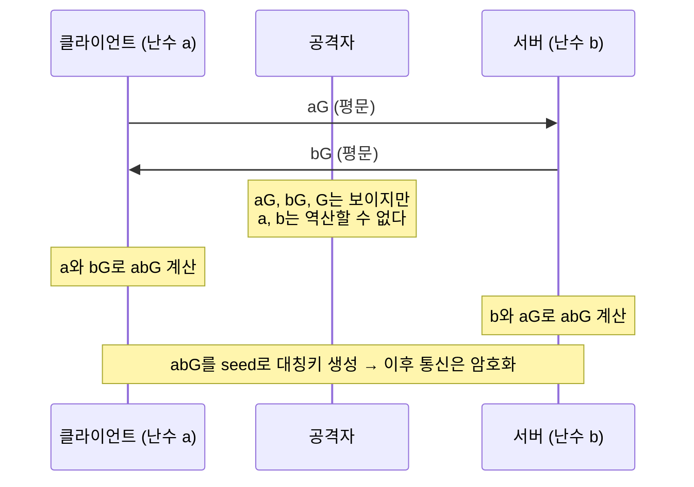
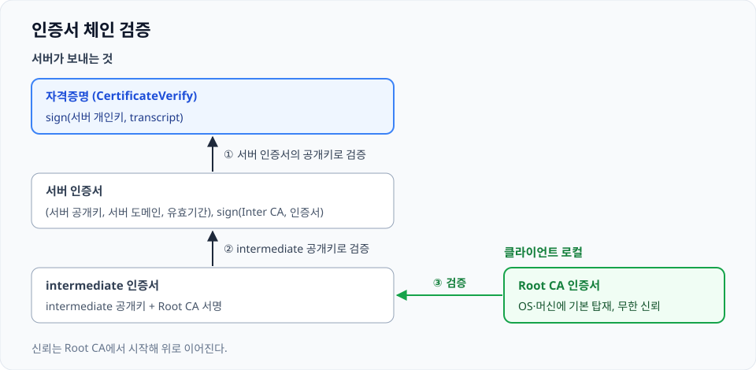
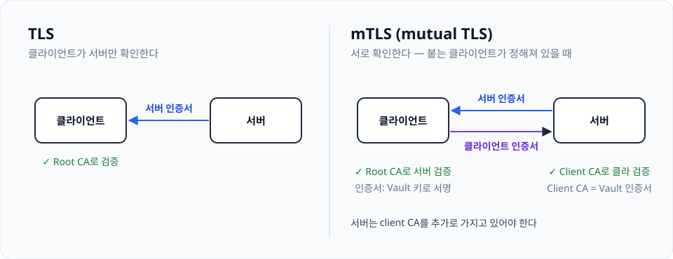

단순하게 생각하면 통신보안(ㅋ)을 달성하는 스택으로 볼 수 있다. 근데 실무를 하면서 "TLS 설정하면 안전해요."라고만 하기엔 부족함이 느껴질 때가 많았다. 궁극적으로는 서버 개발자로서 "이거 왜 안 되냐" 상황에서의 직관이 부족한 게 가장 컸다.

TLS를 달성하기 위해 필요한 준비물은 무엇인지, On-prem을 하게 되면서 RootCA 뭐시기... mTLS 뭐시기... 특히 임의의 클라이언트가 서버에 접근하는 게 아닌, 정해진 클라이언트들이 서버에 접근하는 구성에서 mTLS를 이미 활용하고 있기에 더욱 확실히 알아야겠다는 생각이 들었다.

TLS의 예전 버전과 역사는 시원하게 제끼고, TLS 1.3을 한번 살펴보자. 난 새거 좋아하니까 TLS 1.3을 기준으로 삼았다.

내가 이해하기로는 TLS는 **암호화 파트, 인증 파트** 두 개로 나눌 수 있다.

## 암호화 파트

클라이언트와 서버는 각자 난수를 하나 생성한다. (클라: `a`, 서버: `b`)

RFC 8446 > RFC 7748에 X25519의 공개 상수 값이 있다. (상수: `G`) 타원곡선.. 몽고메리 곡선 어쩌구 방식인데, 머리 좋은 박사님들 감사합니다. 재미는 있는데 암호학을 뜯어보기엔 머리가 영 안 따라준다.

아무튼 각자의 난수 값과 상수 값을 합성해서 새로운 값을 만든다. (클라: `aG`, 서버: `bG`) 그리고 이 두 개의 값을 서로에게 전송한다. 이때 `aG`와 `bG`는 평문으로 전송된다. 공격자는 두 값을 획득할 수 있다.

값을 전달받으면 클라이언트와 서버는 각자 `abG`를 구해낸다. 서버 입장만 살펴보면 `aG`를 받았고, `b`는 아는 값이므로 `abG`를 쉽게 만들 수 있다. 공격자는 `aG`, `bG`, `G`를 모두 알고는 있지만, `abG`를 구하려면 어쨌든 `a`, `b` 값을 역산해내야 한다. 그런데 이 `a`, `b` 역산이 거의 불가능에 가깝다.

비법 소스는 타원곡선 위의 점 연산이다. 뭐.. 자세하게는 잘 모른다만, `aG`는 단순 곱셈이 아니라 점 연산으로 구해진 값이고, 이 계산은 2^255 - 19로 나머지 연산을 하면서 이뤄진다(X25519라는 이름이 여기서 왔다). 그래서 단순히 `aG`를 `G`로 나누거나 점 연산을 거꾸로 되돌리려 해도 나머지 연산 때문에 의미가 없어진다. 노가다로 하나씩 계산해 봐야 하는데, 노가다 시간이 너무 오래 걸려서 현실적으로 해킹이 불가능한 구조라는 게 핵심 원리다.

그렇게 만들어 낸 `abG`를 seed로 해서 암호화/복호화에 사용할 대칭키를 서로 만들어낸다. 데이터 전송에는 공개키를 사용하지 않고 대칭키를 사용하는데, 연산량이 엄청 차이 나서 대칭키를 사용한다. 대칭키를 공유하는 과정에서 탈취당하면 망하지만, 탈취 위험 없이 각자 안전하게 생성하면 장점밖에 안 남는 듯하다.

이렇게 클라이언트-서버 간의 연결된 세션에 대한 안전한 대칭키가 준비됐다. 이제부터 통신은 암호화되어 진행된다.

> [RFC 8446: The Transport Layer Security (TLS) Protocol Version 1.3](https://datatracker.ietf.org/doc/html/rfc8446)  
> This document specifies version 1.3 of the Transport Layer Security (TLS) protocol. TLS allows client/server applications to communicate over the Internet in a way that is designed to prevent eavesdropping, tampering, and message forgery. This document updates RFCs 5705 and 6066, and obsoletes RFCs ...

> [RFC 7748: Elliptic Curves for Security](https://datatracker.ietf.org/doc/html/rfc7748#section-4.1)  
> This memo specifies two elliptic curves over prime fields that offer a high level of practical security in cryptographic applications, including Transport Layer Security (TLS). These curves are intended to operate at the ~128-bit and ~224-bit security level, respectively, and are generated determini...

## 인증 파트

우선 공개키/개인키의 알지 못했던 활용법을 배웠다. 여태까지 공개키(자물쇠)로 잠가놓으면 개인키(열쇠)를 가진 사람만 열어볼 수 있다는 암호학적 활용만 알고 있었는데, 반대도 가능하다. 개인키로 서명을 만들고, 공개키로 그 서명이 맞는지 검증하는 식이다. 이걸 **서명**이라고 하더라. 개인키로 서명 → 공개키로 검증.

암호화까지 성공하면 비밀대화를 시작할 수 있다. 근데 상대방이 누구인지는 아직 모르는 상태다. 지금 간이며 쓸개며 다 내줬다간 바로 로맨스스캠 당하는 거다.

TLS에서는 서버가 인증서를 클라이언트에게 보낸다. 인증서에 담긴 내용은 서버 공개키, 서버 도메인, 유효기간이다. 어떻게 보면 신분증과 비슷하다. 서버가 본인을 증명하기 위한 증서니까.

근데 서버가 제안한 게 다른 사람의 신분증을 빌려왔거나, 예전에 찍어둔 사진이면 어떡하냐? "아직 인증되지 않은 서버"가 자격증명으로 내미는 것을 아직 곧이곧대로 믿을 순 없다.

그래서 공증이 필요하다. 누군가 보증을 해줘야 한다! 그게 CA다. Certificate Authority. CA가 인증서 내용(서버 공개키, 서버 도메인, 유효기간) 전체에다가 CA 개인키로 서명해준다. 그래서 서버가 전송하는 인증서에는 서버 공개키, 서버 도메인, 유효기간, CA 서명이 들어있다.

근데 또 문제가 있다. CA의 공개키를 어디선가 획득하려면 또 어떤 서버와 연결을 맺어서 가져와야 한다. 그럼 그 서버는 어떻게 믿을 거냐??? 이렇게 점점 미루다 보면 끝도 없다. 그래서 한번 끊어주는 역할이 **Root CA** 개념이다. 이건 OS 자체나 머신에 기본으로 들어있는 CA 인증서 목록이다. 이 리스트는 무한 신뢰. 이것조차 믿지 않으면 아무것도 할 수 있는 게 없다.

클라이언트는 서버로부터 인증서를 전달받고, 클라이언트 로컬에 저장된 Root CA로 인증서 서명을 검증한다. 이러면 인증서 내용은 사실임이 증명된다.

그런데 두 가지 문제가 있다.

1. 공격자가 인증서도 그냥 같이 전달하면 되는 거 아닌가요?
2. Root CA로 서명 받기가 쉬운가요?

### 1번 문제: 인증서를 그대로 들고 오면?

공격자가 인증서도 그냥 같이 전달하면 지금까지 과정으로는 클라이언트가 공격자를 믿을 수밖에 없다. 실제로 CA 서명된 인증서는 누구나 받을 수 있는 공개된 정보다.

꼭 확인해야 할 건, "니가 이 공개키의 진짜 주인이 맞아? 너 이 공개키와 짝인 개인키 가지고 있는 거 증명해봐"다. TLS 1.2의 RSA 키 교환 방식에서는 대칭키 생성을 위한 seed 난수를 전달할 때 서버의 공개키로 암호화 → 서버가 개인키로 복호화를 하기 때문에 인증서의 공개키의 주인이 서버임이 암호화 단계에서 확인되지만, TLS 1.3에서는 아직까지 인증서의 공개키/개인키가 사용된 적이 없다.

그래서 서버는 인증서를 보내면서 `CertificateVerify` 자격증명을 같이 보낸다.

근데근데근데!!! 공격자가 `CertificateVerify`도 복사해두고 사용하면 어떡하냐? 여기서 암호화 단계에서 사용되었던 난수가 한 번 더 사용된다. 서버는 `CertificateVerify`를 생성할 때, 지금까지 해당 연결에서 주고받았던 모든 메시지(transcript)에다가 서버의 개인키로 서명한다. 그래서 공격자가 복사해두더라도 그 자격증명은 다른 세션에서는 무용지물이다.

다시 돌아와서 정리하면, 서버는 인증서와 자격증명을 보낸다. 클라이언트는 자격증명을 서버 인증서의 공개키로 검증하고, 서버 인증서를 Root CA 공개키로 검증한다. 끝났다! 이제 확실히 누구랑 비밀대화를 하는지 알 수 있다. (무조건 신뢰하는 Root CA 덕분이다.)

### 2번 문제: Root CA는 함부로 못 꺼낸다

Root CA는 정말 중요하다. Root CA의 개인키가 탈취당하면 전 세계 해킹이 가능하거나, 키를 폐기해서 전 세계 인증서를 다시 발급하는 문제가 생긴다. 나의 밤티 같은 사이드 프로젝트 서버 인증서에 서명해주기 위해 Root CA 개인키를 꺼내는 건 리스크가 굉장히 높다.

그래서 계층 구조를 가진다. Root CA가 몇몇 intermediate CA에 인증서를 발급해주고, intermediate CA가 나의 밤티 서버 인증서에 서명해준다.

그럼 서버가 보내는 내용이 다음과 같아진다.

- 인증서: `(서버 공개키, 서버 도메인, 유효기간), sign(Inter CA, 인증서)`
- 자격증명: `sign(서버 개인키, transcript)`

`sign(a, b)`의 의미는 b에 대해 a로 서명했다는 것.

그런데 클라이언트 Root CA에는 intermediate CA 공개키가 없다. 크롬 같은 브라우저에서는 AIA?를 통해서 intermediate CA를 찾아와서 해결해준다. 그러나.. 보통 우리가 쓰는 라이브러리는 그런 게 구현되어 있지 않으니, intermediate의 공개키를 클라이언트에게 같이 알려줘야 한다.

그리고 역시! 클라이언트는 이 intermediate 공개키도 "니가 보낸 이 공개키가 진짜 이 기관 거 맞아?"를 검증해야 한다. intermediate 인증서를 통해서 공개키를 전달하고, 이 인증서에는 진짜 Root CA가 서명했기 때문에 로컬에서 검증할 수 있다.

그럼 다시 정리하자. 서버는 intermediate 인증서, 서버 인증서, 자격증명을 보낸다. 정확하게는 Root CA까지 이어지는 **인증서 체인**을 보낸다.

- 클라이언트는 서버 인증서로 자격증명을 검증,
- intermediate 인증서로 서버 인증서를 검증,
- root CA 인증서로 intermediate 인증서를 검증한다.

{: w="960" h="470" }
_서버가 보내는 인증서 체인과 클라이언트의 검증 순서_

## 서버가 준비할 것

여기까지가 TLS 1.3의 동작이다. 나는 보통 서버의 입장이니까 서버에서 준비해야 될 걸 정리해보자.

- 서버의 개인키 (공개키는 인증서에)
- 서버의 인증서 (intermediate가 포함된 chain 형태)

두 가지다.

## mTLS

mTLS, mutual TLS. 클라-서버 상호 인증하는 개념이다. 암호화는 하던 대로 하고, 클라이언트가 서버 인증서를 검증하듯 서버도 클라이언트 인증서를 검증한다.

왜 필요한가 생각해봤는데, 보통 웹 서비스에서는 클라이언트 하나하나를 특정할 수 없으니 애초에 mTLS를 쓰기 어려운데, 로봇 운영 환경처럼 서버에 붙는 클라이언트가 정해져 있을 땐 mTLS를 사용하면서 얻는 보안적 이점이 크다. 서버 입장에서도 맵 정보나 사이트 특화된 정보들을 내보낼 수 있으니, 기본적으로 성능에 문제가 없다면 보안을 챙겨놓으면 좋다고 생각한다.

방식은 동일하다. 서버 인증서를 검증하는 것처럼 클라 인증서를 서버가 검증한다. 클라 인증서를 검증할 수 있는 client CA를 서버가 추가로 가지고 있어야 한다.

{: w="960" h="370" }
_TLS와 mTLS의 인증 방향 비교_

클라이언트 인증서를 Vault에 저장된 키로 서명하고, Vault 인증서를 서버의 Client CA로 넣어두면 된다.

다음번에는 Vault는 무엇인지, 인증서 갱신은 어떻게 하는지, 프록시와 LB가 끼어들면 어떻게 되는지 살펴보자.
