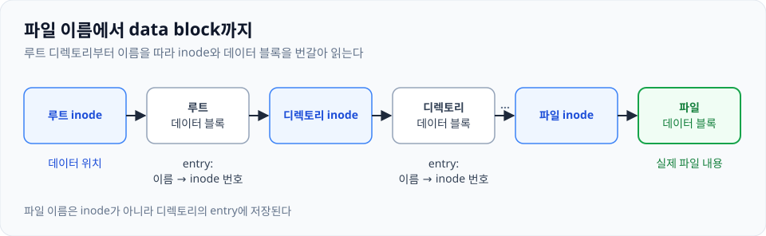
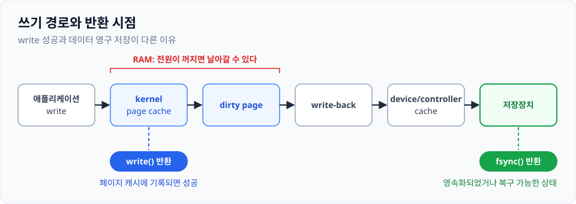

## 오늘 읽을 페이지

**필독**
- 제36장 I/O 장치: **p.455~468**
- 제39장 파일과 디렉터리: **p.509~533**
- 제40장 파일 시스템 구현: **p.537~553**
- 제42장 크래시 일관성, FSCK와 저널링: **p.573~591**

**선택**
- 제37장 하드 디스크 드라이브: **p.471~484**
- 제38장 RAID: **p.489~505**
- 제41장 Fast File System: **p.557~568**
- 제44장 플래시 기반 SSD: **p.613~632**

## 오늘의 목표

애플리케이션의 `write()`가 실제 저장장치에 안전하게 반영되기까지의 과정을 설명한다.

## 읽을 주제

**파일시스템과 영속성**
- 파일과 디렉터리
- file descriptor
- inode와 data block
- directory entry
- hard link와 symbolic link
- free-space 관리
- buffer/page cache
- write-back
- crash consistency
- journaling
- fsync
- 디스크와 RAID는 핵심 특성과 trade-off 위주

## 반드시 답할 질문

### file descriptor는 무엇을 가리키는가?

프로세스가 열고 있는 파일을 가리킨다. 이 open은 세션의 개념이라, 같은 파일을 두 번 열면 다른 fd로 관리된다. (offset 별도)

### 파일 이름에서 실제 data block까지 어떻게 찾아가는가?

루트 디렉토리부터 파일 이름을 찾는다.

루트 inode > 루트 데이터 블록 > 디렉토리 inode > 디렉토리 데이터 블록 > ... > 파일 inode > 파일 데이터 블록

{: w="960" h="296" }
_파일 이름에서 data block까지 찾아가는 경로_

### inode에는 무엇이 저장되고 파일 이름은 어디에 저장되는가?

- inode: 파일 종류, 권한, 소유자, 크기, 시간 정보, 링크 수, 데이터 위치
- 디렉토리의 entry에 파일 이름과 대상 inode 번호의 대응이 저장된다.
- 일반 파일의 데이터 블록에는 실제 파일 내용이 저장된다.

### hard link와 symbolic link는 무엇이 다른가?

하드링크는 파일에 이름을 하나 더 붙이는 것. 이름이 파일에 대한 포인터라고 생각하면 된다. 같은 파일을 가리키는 다른 포인터의 삭제는 하드링크된 다른 이름들에 영향을 주지 않는다. 그러나 디렉토리에는 사용할 수 없고, 같은 파일 시스템 안에서만 가능하다는 한계가 있다.

심볼릭링크는 다른 파일을 가리키는 파일을 생성한다. 디렉토리 역시 이 대상이 될 수 있으며, 다른 물리 파티션에 존재해도 생성할 수 있다. 가리키고 있는 원본 파일이 삭제되는 경우, dangling pointer 현상이 발생한다.

### 파일을 삭제했는데 열린 file descriptor로 계속 읽을 수 있는 이유는?

파일 삭제는 디렉토리에서 이름을 제거하는 `unlink` 동작이다. 이미 열어둔 fd는 파일 이름을 통해서가 아닌 파일 객체를 통해 접근하므로, 여전히 디스크의 주소에 접근할 수 있다. 링크된 이름도 없고 열린 파일 객체도 없으면 파일이 회수된다.

### write()가 성공하면 데이터가 디스크에 기록된 것인가?

RAM의 페이지 캐시에 기록되고, 실제 영구적으로 디스크에 기록된 상태는 아니다. 이는 쓰기 성능 향상을 위해 쓰기 작업을 모아서 처리하는 버퍼 역할이다. 즉시 쓰기를 원한다면 `fsync`를 사용해서 디스크에 영속화되었음을 확인받을 수 있다.

### page cache는 읽기와 쓰기에 어떤 영향을 주는가?

- 캐시에 내용이 있으면 디스크 접근 없이 읽을 수 있다.
- 변경 내용을 메모리에 먼저 반영해서 디스크 호출까지 기다리지 않아도 된다.
- 아직 디스크에 반영되지 않은 변경 page(dirty page)도 읽어갈 수 있다.

### delayed write/write-back은 왜 필요한가?

디스크 작업은 시간이 오래 걸린다. 단순한 파일 쓰기에도 I/O는 여러 번 발생한다. inode 및 디렉토리 탐색 때문이다. 대신 이런 작은 쓰기 작업을 모아서 처리하면 몇 가지 장점이 있다.

- 실제 쓰기의 오버헤드를 하나로 합쳐서 줄일 수 있고, 같은 위치가 여러 번 수정되는 경우에는 한 번만 쓰면 된다.
- 작업을 키워서 DMA에 던지면 CPU-bound, I/O-bound 작업을 병렬로 수행할 수 있다.

다만, 전원이 꺼지면 기록이 안 된 데이터가 날아갈 수 있다.

### 갑자기 전원이 꺼지면 어떤 메타데이터 불일치가 발생할 수 있는가?

데이터 블록은 갱신되었으나 inode, 데이터 블록 bitmap은 갱신되지 않을 수 있다. 혹은 반대로 메타데이터는 갱신되었으나 실제 데이터는 갱신되지 않아 잘못된 값을 읽는 경우도 발생한다.

### journaling은 무엇을 먼저 기록하며 왜 복구가 쉬워지는가?

메타데이터를 갱신하기 전에 갱신하겠다는 내용을 저널에 기록한다. 저널에 TXB, ib, db를 기록하고, 그 기록이 끝나면 TXE로 트랜잭션을 닫는다(커밋). 그 다음에 ib, db를 실제 위치에 반영한다(체크포인트). 크래시 이후에 저널의 트랜잭션 기록을 확인하면 빠르게 복구가 가능하다.

근데 메타데이터 저널은 실제 파일 데이터를 저널에 넣는 건 아니라서 반드시 파일 내용까지 보장되는 건 아님.

### fsync()는 어떤 보장을 요청하는가?

파일의 수정된 데이터와 메타데이터를 영속화했음을 보장받을 수 있다. 명령어를 호출한다고 영속화되는 게 보장되는 건 아니다. `fsync()`가 리턴할 때 영속화되었거나, 복구 가능한 상태가 되었음을 보장한다.

단, 주의사항은 파일을 포함한 디렉토리는 따로 영속화해주어야 완전히 보장받을 수 있다는 점.

### atomic rename이 파일 교체에 자주 사용되는 이유는?

다른 프로세스가 중간까지의 상태를 보지 않게끔 임시 파일을 만들어서 준비 후, `rename`한다. `rename`의 원자성과 `fsync()`를 사용해서 원자성+영속성을 챙길 수 있다고 한다.

### RAID는 성능, 용량, 장애 허용성 사이에서 어떤 선택을 하는가?

용량은 최대 디스크 묶음 전체의 용량이지만, 그건 RAID 0일 때 이야기다. RAID 레벨에 따라서 달라지지만 미러링의 경우 용량은 절반, 두 번 써야 하니 쓰기 성능도 절반(읽기는 어느 쪽에서든 읽을 수 있다), 대신 미러 디스크가 고장 나도 데이터는 유지된다.

보통은 용량과 성능을 일부 희생하여 디스크 장애에도 데이터를 잃지 않도록 하는 기술이다.

## 반드시 그릴 그림

경로명 → 상위 디렉터리 inode → directory entry → 대상 inode → direct/indirect block pointer → data block

그리고 쓰기 경로를 그린다.

애플리케이션 write → kernel page cache → dirty page → write-back → device/controller cache → 저장장치

각 단계에서 `write()`와 `fsync()`가 반환하는 시점을 표시한다.

{: w="960" h="340" }
_쓰기 경로와 `write()` / `fsync()`의 반환 시점_

## 실습

아래 중 두 개를 선택한다.
- `strace`로 `openat`, `read`, `write`, `fsync`, `close` 관찰
- 파일을 열어둔 상태에서 삭제하고 열린 descriptor를 통해 접근되는지 확인
- `stat`으로 inode와 link count 관찰
- hard link와 symbolic link를 만들고 원본 삭제 후 차이 확인
- 작은 파일을 반복해서 쓰며 `fsync` 유무의 성능 차이 측정
- `lsof`로 프로세스가 열고 있는 파일 확인

## 오늘의 결과물

- 파일 읽기/쓰기 경로 그림 각 1개
- 2분 설명: **"write 성공과 데이터 영구 저장이 다른 이유"**

## 내 노트

디스크는 버스를 통해 시스템에 연결된다. 장치 드라이버는 "어떤 논리 블록을 읽거나 써라"라고 하는 인터페이스를 제공한다. 디스크 암 이동이나 내부의 블록 배치 등은 장치 내부에서 관리한다.

OS는 장치 레지스터에 접근할 때, 메모리 주소로 접근하는 Memory-Mapped I/O나 별도 포트 공간을 쓰는 in/out 명령을 사용한다. CPU에서 I/O 작업을 DMA에 시켜 RAM 데이터를 디스크에 쓰고, CPU는 다른 작업을 수행하도록 병렬성을 높일 수 있다.

디스크는 외부에 논리 블록 공간을 제공한다. 그것을 어떤 구조로 나누고 사용할지는 디스크가 아닌 파일 시스템이 담당한다. 파일 시스템은 그 공간을 나눠서 파일과 메타데이터를 관리하고 파일, 디렉토리, 이름이라는 구조를 제공한다. 파일 시스템은 파일 위치, 이름, 권한, 빈 공간 등을 관리하고 캐시와 크래시 상태 복구 등을 지원한다.
