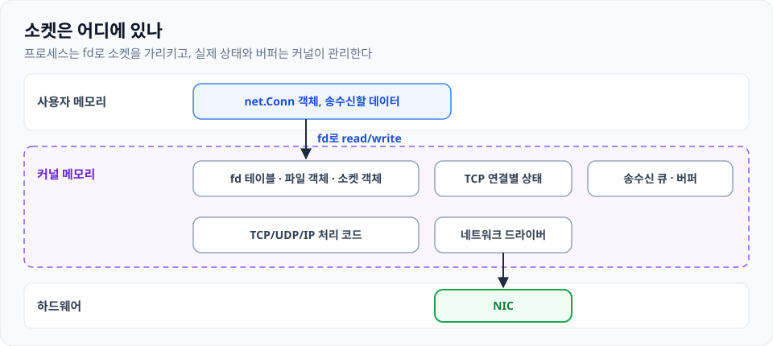

회사에서 WebRTC 이야기를 들으면서 다시 생각난 주제인데, "아니 그래봤자 TCP/UDP 소켓에다가 읽고 쓰는 것뿐이잖아? 소켓을 뭐 기깔나게 쓰기라도 하는 건가?"라는 궁금증이 떠올랐다.

그래서 우선 HTTP 버전별 특징 차이가 혹시 소켓에서 지원되는 기능이 바뀐 게 있는지 알아보려고 한다.

| 버전 | 프로토콜 | Connection 재사용 | Connection 내 Req/Resp |
|---|---|---|---|
| HTTP/1.0 | TCP | 기본 1회성 | 한 쌍 |
| HTTP/1.1 | TCP | 기본 재사용 | 여러 요청 순차 응답 |
| HTTP/2 | TCP | 재사용 | 스트림 다중화 |
| HTTP/3 | QUIC (UDP) | 재사용 | QUIC 스트림 다중화 |

보면, 연결을 1회만 사용하다가 재사용하는 방향으로 바뀌었다. 이 변화가 기반 TCP나 소켓 기술의 발전으로 이뤄진 것인가? 댓츠 논노 그렇지 않다. 사실 HTTP/1.0에서도 keep-alive를 지원하는 HTTP 구현체끼리는 연결 재사용이 가능하다.

아래는 Go 언어로 만들어본 간단한 keep-alive 예시다.

```go
func serveConn(conn net.Conn, reuse bool) {
  defer conn.Close()

  reader := bufio.NewReader(conn)

  for {
    req, err := readCompleteHTTPRequest(reader)
    if err != nil {
      return
    }

    closeAfterReply := !reuse || req.Close

    err = writeHTTPResponse(conn, handle(req), closeAfterReply)
    if err != nil {
      return
    }

    if closeAfterReply {
      return
    }
    // 같은 conn에서 다음 HTTP 요청 대기
  }
}
```

서버의 재사용 옵션(`reuse`)과 클라의 요청 후 처리(`req.Close`)에 따라 conn을 살릴지 말지 선택할 수 있다. `net.Conn`은 별다른 역할을 하지 않는다. **Application 계층에서 살릴지 말지를 결정하는 거지.**

뭐 HTTP를 열심히 뜯어볼 건 아니라서.. 여기서 알 수 있는 건 TCP/UDP는 사용하는 입장에서 복잡한 게 아니다. 단순히 상대 IP:Port와 양방향 데이터 통신이 가능한 통로일 뿐. 전송되는 데이터의 의미나 구조는 관여하지 않는다.

OS에서는 **소켓**이라는 형태로 이 통신 끝점을 제공한다. 소켓은 생성, 연결 요청, 송수신, 종료 인터페이스를 제공한다. 위에서 이야기한 "한 요청을 처리한 뒤 연결을 닫는다" 같은 기능은 없다.

## 이 소켓은 어떻게 존재하나?

Linux에서 프로세스가 사용할 소켓을 가리킬 때도 file descriptor를 사용한다.

| **구성 요소** | **실제 위치** | **역할** |
|---|---|---|
| net.Conn 객체, 송수신할 데이터 | 프로세스의 사용자 메모리 | 프로그램이 통신을 위한 객체와 데이터 |
| fd 테이블, 파일 객체, 소켓 객체 | 커널 메모리 | 프로그램의 fd를 실제 소켓과 연결 |
| TCP 연결별 상태 | 커널 메모리 | 주소, 포트, 연결 상태, 시퀀스 번호, 윈도 크기 등을 관리 |
| 송수신 큐와 데이터 버퍼 | 주로 커널 메모리 | 전송하거나 수신한 데이터를 보관 |
| TCP/UDP/IP 처리 코드 | 메모리에 올라온 커널 코드 | 패킷 생성, 해석, 재전송, 경로 선택 등을 수행 |
| 네트워크 드라이버와 NIC | 드라이버는 커널, NIC는 하드웨어 | 커널과 장치를 연결하고 실제 신호를 송수신 |

{: w="960" h="430" }
_위 표를 메모리 위치별로 쌓은 그림_

디스크 파일에 read/write 하는 것처럼 소켓 fd에 read/write를 하면, 커널이 그걸 NIC까지 전달한다. 그 아래의 1, 2, 3계층에서 상대방을 찾아주고, TCP/UDP 소켓은 4계층 추상화라고 생각하면 될 듯하다? 단순 unix 소켓도 있으니까 소켓 == 4계층이라고 말하는 건 좀 아니다. 뭐.. 도커 소켓? 이것도 TCP/UDP는 아니니까.

그래서 소켓이 무엇이냐, 아주 멋진 현대의 통신 프로토콜은 무엇이냐.. 에 대한 내 감상은, 통신을 위한 우편함(사실 우편함 표현이 올드하다고 생각하는데 다른 비유가 생각이 안 난다 ㅋ)이 소켓이고, 아파트 우편함이 집집마다 하나씩 잘 관리되는지, 우편이 경비실에 다 맡겨지는지 등등의 차이가 있을 뿐, **그 우편 내용을 어떻게 처리할지는 그 위에서 쌓아 올려야 하는 것이지.**

## 소켓 만들기와 커스텀

리눅스에서 소켓을 만들 때는 세 가지 파라미터를 받아서 만든다.

```c
socket(domain, type, protocol);

socket(AF_INET, SOCK_STREAM, IPPROTO_TCP); // TCP 바이트 스트림
socket(AF_INET, SOCK_DGRAM, IPPROTO_UDP);  // UDP 데이터그램
socket(AF_UNIX, SOCK_STREAM, 0);           // 로컬 바이트 스트림
```

QUIC도 결국 UDP 소켓 위에서 나름의 커스텀이 들어갔다고 보면 된다. 소켓 커스텀 요소도 조사해봤다.

| **커스텀 요소** | **구현하는 방법** |
|---|---|
| 논블로킹 여부, 버퍼 크기, 타임아웃 조정 | OS가 제공하는 소켓 옵션 사용 (setsockopt()) |
| 메시지 형식, 요청, 응답 규칙 정의 | 기존 소켓 위에 직접 프로토콜 구현 |
| 새로운 재전송 순서 보장 방식 구현 | UDP 위에 라이브러리를 만들거나 더 낮은 수준의 구현 사용 |
| 새로운 타입을 OS 소켓 API로 제공 | 커널 쪽에 해당 기능 구현, 등록 필요 |
